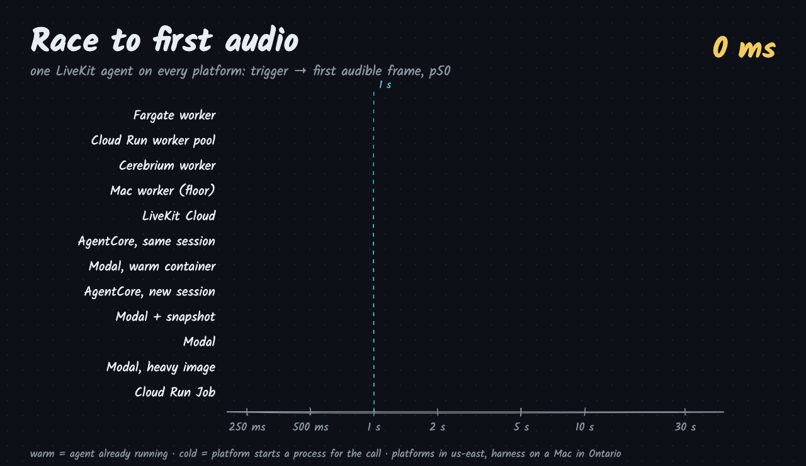
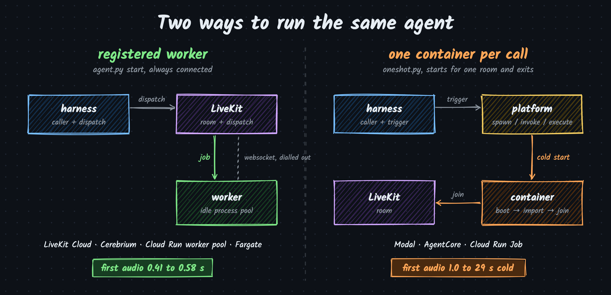
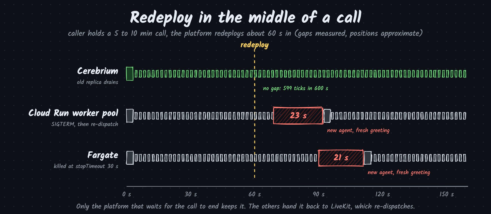

<p align="center">
  
</p>

<h3 align="center">How long a caller waits for a LiveKit agent, on every serverless platform.</h3>

<p align="center">
  
  
  
  
  
</p>

One identical agent, deployed everywhere. It plays a 1 s tone the moment it joins, then a 100 ms tick every second.
There is no STT, LLM or TTS, so the numbers measure the platform and nothing else.

## TL;DR

First audio = trigger to the first audible frame the caller hears. p50 / p90.

| Platform | Shape | State | Runs | First audio p50 | p90 |
| --- | --- | --- | --- | --- | --- |
| Fargate | registered worker | warm | 20 | **0.41 s** | 0.47 s |
| Cloud Run worker pool | registered worker | warm | 20 | **0.43 s** | 0.51 s |
| Cerebrium | registered worker | warm | 20 | **0.44 s** | 0.49 s |
| Mac on home Wi-Fi (floor) | registered worker | warm | 20 | 0.55 s | 0.66 s |
| LiveKit Cloud (Build plan) | registered worker | warm | 20 | 0.58 s | 0.68 s |
| AgentCore, same session | per call | warm | 21 | 0.58 s | 0.70 s |
| Modal, 5 s gap | per call | warm | 20 | 0.67 s | 0.88 s |
| AgentCore, new session | per call | cold | 20 | 1.01 s | 1.56 s |
| Modal + memory snapshot | per call | cold | 20 | 3.36 s | 6.23 s |
| Modal | per call | cold | 20 | 4.44 s | 5.70 s |
| Modal, heavy image (+ Silero VAD) | per call | cold | 10 | 8.09 s | 10.95 s |
| Cloud Run Job | per call | cold | 10 | 29.1 s | 31.3 s |

## Findings

- **A registered worker is the only shape under 0.6 s every time.** The worker is already connected, so a call costs dispatch + connect.
- **AgentCore "cold" is not a boot.** New sessions land on pre-booted microVMs whose process imported about 69 s before the invoke. A new session costs about 1 s.
- **Modal cold is about 4.4 s, and most of it is Modal's own startup.** Container start 1.73 s, Modal runtime and app load 1.85 s, agent imports 0.46 s, connect 0.31 s, first audio 0.09 s. A memory snapshot saves 1.1 s (light) and 2.8 s (heavy), but its p90 is noisy.
- **Cloud Run Jobs are not usable per call.** The container starts 27 s after `jobs execute`.
- **LiveKit Cloud's Build plan never scaled to zero in 40 min idle**, so there is no cold number for it. It caps you at 5 concurrent sessions and queues dispatch number 6 for about 2 min.
- **Cerebrium cannot scale a registered worker from zero.** `min_replicas = 0` is rejected for CPU scaling, and the worker gets no HTTP traffic to scale on.

<p align="center">
  
</p>

## Redeploys drop calls

A caller held a 5 to 10 min call while the platform redeployed about 60 s in.

<p align="center">
  
</p>

| Platform | Result | Silence | Agents that joined |
| --- | --- | --- | --- |
| Cerebrium (`response_grace_period = 900`) | survived | 0 s | 1 |
| Cloud Run worker pool | dropped, re-dispatched | 22.9 s | 2 |
| Fargate (ECS `stopTimeout` 30 s) | dropped, re-dispatched | 21.2 s | 2 |

The LiveKit worker drains on SIGTERM. Cloud Run and ECS kill it before the call ends, and LiveKit hands the job to the new worker, which starts again with a fresh greeting.

## How it's measured

The harness joins a fresh room as the caller, fires a trigger, and listens. It records:

| Field | Meaning | Clock |
| --- | --- | --- |
| `join_ms` | trigger to agent participant joined | harness |
| `first_audio_ms` | trigger to first frame above an RMS threshold | harness |
| `agent.*` | process start, imports done, job received, connected, published | agent, sent as a data packet |
| `survived`, `max_tick_gap_s`, `agent_joins` | hold runs: did the ticks keep coming through a redeploy | harness |

The trigger is whatever starts the agent: a LiveKit dispatch to a registered worker, a Modal `spawn`, an AgentCore `invoke_agent_runtime`, or any CLI (`gcloud run jobs execute`). Per-step medians are in [`results/NOTES.md`](results/NOTES.md); raw runs are in `results/*.jsonl`.

## Reproduce

```sh
git clone https://github.com/mahimairaja/livekit-coldstart-bench && cd livekit-coldstart-bench
uv venv && uv pip install -r harness/requirements.txt -r agent/requirements.txt modal==1.6.1
source .venv/bin/activate
export LIVEKIT_URL=wss://<project>.livekit.cloud LIVEKIT_API_KEY=... LIVEKIT_API_SECRET=...

# a registered worker anywhere, then dispatch to it
cd agent && python agent.py start &
cd ../harness && python bench.py --platform mac-worker --trigger dispatch --label warm --runs 20 --gap 3

# one container per call on Modal
modal deploy ../platforms/modal_app.py
BENCH_MODAL_FN=run_call python bench.py --platform modal --trigger modal --label cold --runs 20 --gap 30

python summarize.py results.jsonl
```

Deploy files per platform are in [`platforms/`](platforms). Set `LIVEKIT_AGENT_NAME_OVERRIDE` and `BENCH_AGENT_NAME` when two workers share a project. Rebuild the visuals with [`docs/assets/src/render.mjs`](docs/assets/src/render.mjs).

## Roadmap and contributing

Six platforms are covered so far. What's next is in [ROADMAP.md](ROADMAP.md), and [CONTRIBUTING.md](CONTRIBUTING.md) shows how to add a platform in five steps.

## Cost

About $2 for everything above: Modal $1.02 (mostly a now-fixed bug that kept containers alive), Cerebrium, Cloud Run, Fargate, CodeBuild and AgentCore well under $1 combined, LiveKit Cloud $0 on the Build plan.

## Caveats

- Small samples: 10 to 21 runs per row, one day, one region (us-east), one harness location (Ontario).
- Light agent only, except the Modal heavy rows. Real agents with STT/LLM/TTS imports start slower.
- Client overhead is included: `gcloud` and boto3 trigger calls count toward first audio.
- LiveKit Cloud ran on the free Build plan; paid plans keep agents warm.
- The Cloud Run drain tick count suggests the two agents overlapped. Unconfirmed.
